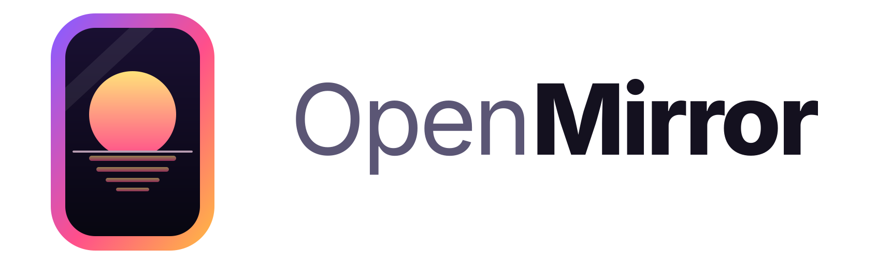
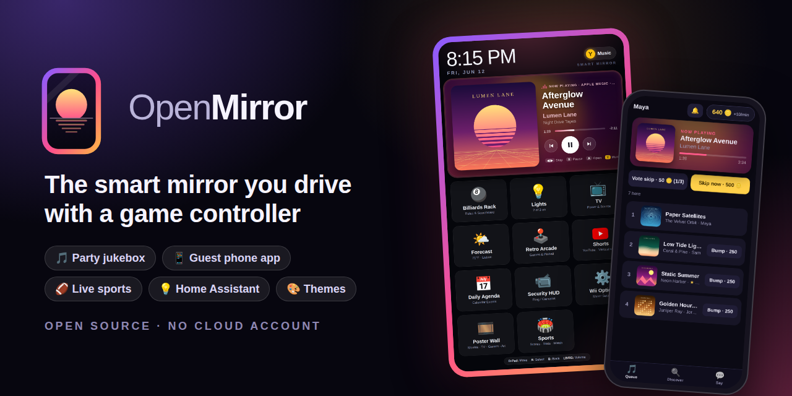
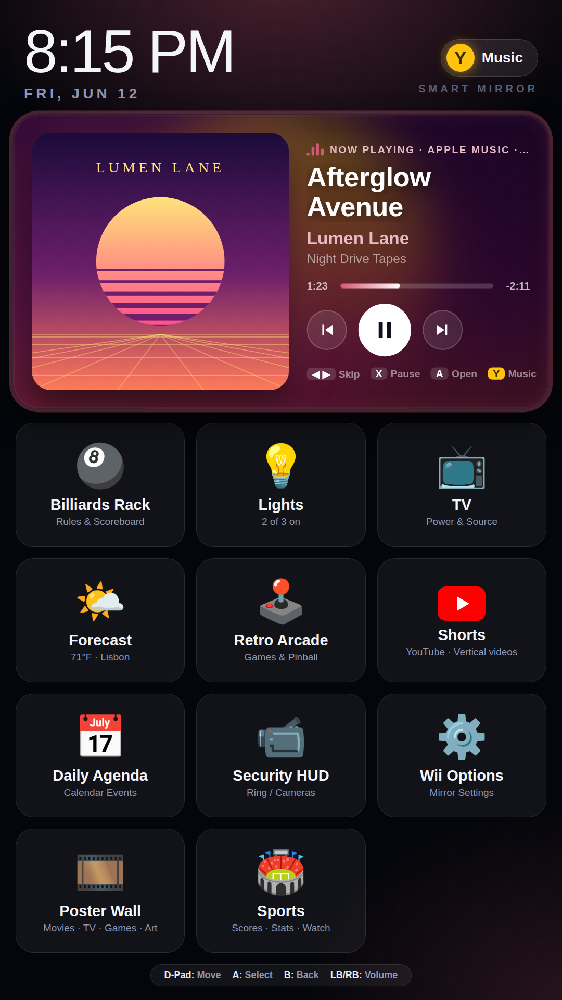
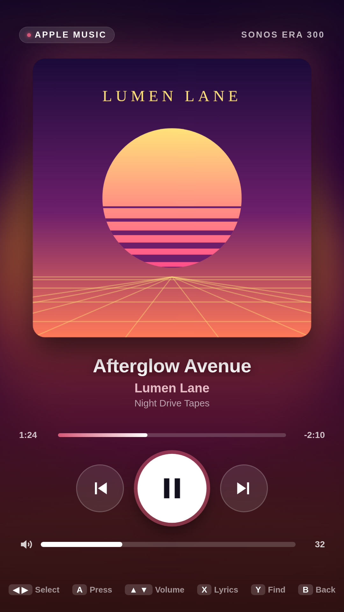
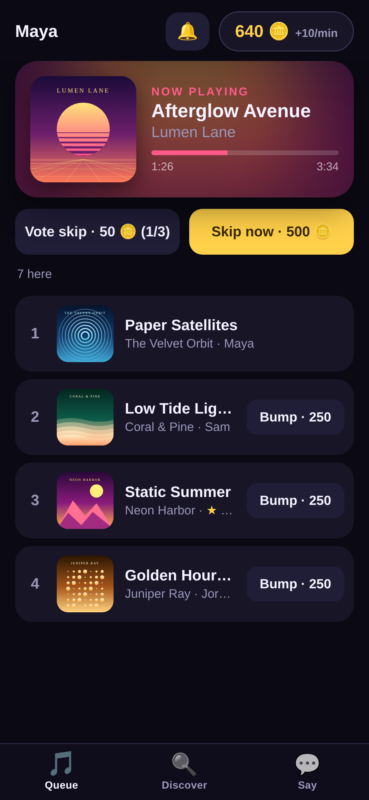
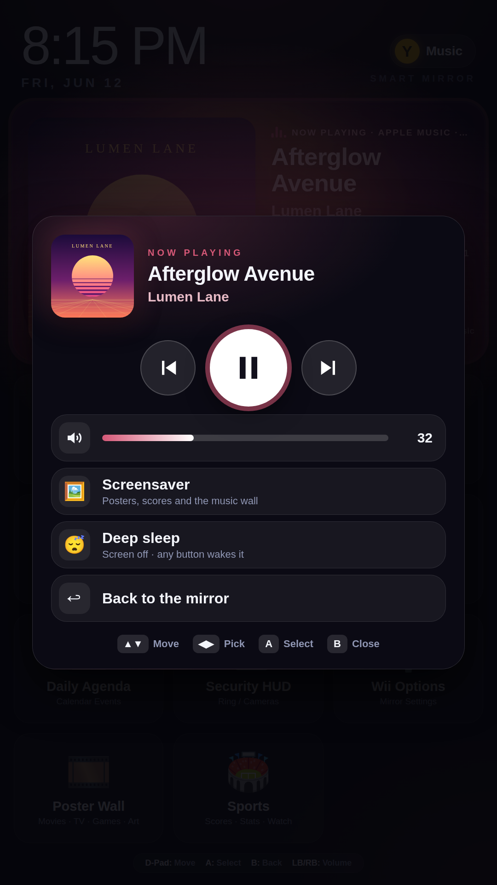
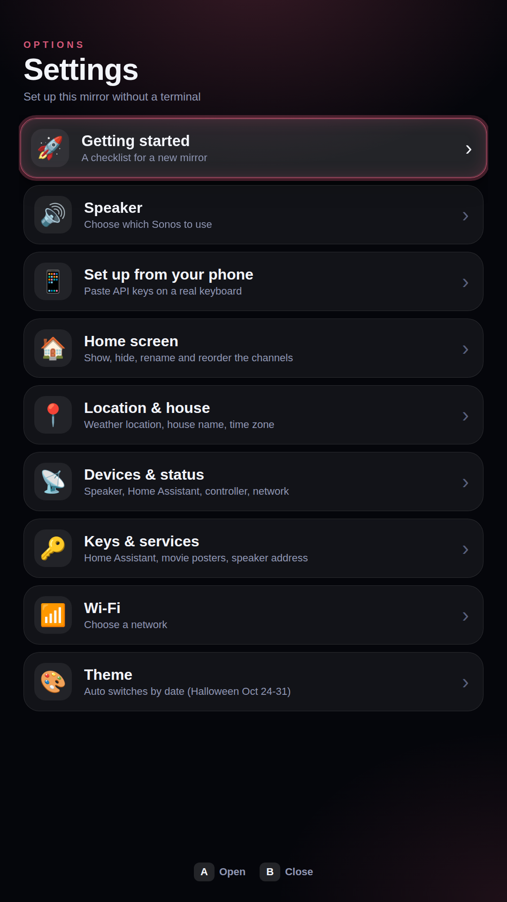
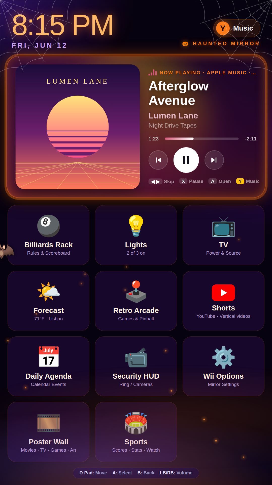

<p align="center">
  <picture>
    <source media="(prefers-color-scheme: dark)" srcset="docs/assets/logo-dark.svg">
    
  </picture>
</p>

<p align="center">
  <b>The smart mirror you drive with a game controller.</b><br>
  A channel menu on a portrait screen, a party jukebox your guests run from their phones,<br>
  live sports that never spoil the TV, and themes that change with the seasons.
</p>

<p align="center">
  <a href="LICENSE"></a>
  <a href="https://github.com/kinghardy/openmirror/actions/workflows/ci.yml"></a>
  
  <a href="CONTRIBUTING.md"></a>
</p>

<p align="center">
  <a href="#quick-start">Quick start</a> ·
  <a href="#a-closer-look">Screenshots</a> ·
  <a href="docs/THEMES.md">Make a theme</a> ·
  <a href="https://github.com/kinghardy/openmirror/discussions">Discussions</a> ·
  <a href="docs/ROADMAP.md">Roadmap</a>
</p>

<p align="center"></p>

## Why

Most smart mirrors are a clock and the weather. OpenMirror is built for a room where people hang out: a game room, a basement bar, a kitchen. You pick up an Xbox controller and get a TV-style channel menu. Your guests scan a QR code and queue songs on the speaker. The mirror runs on an old laptop or a small PC, needs no cloud account, and you set it up on the mirror itself, not in a terminal.

## What it does

- 🎮 **A channel menu for the couch.** A home screen of tiles (music, lights, arcade, posters, sports and more) that you drive with a game controller. Choose, rename and reorder channels on the mirror.
- 🎵 **A party jukebox.** Search that forgives typos, a shared queue, a party mode that never stops, synced karaoke lyrics, playback on a Sonos speaker.
- 📱 **A phone app for your guests.** They scan a QR code and get an installable app: request songs, vote to skip, bump a favourite with coins, post to the wall on the big screen, get a push notification when their song is up.
- 🏈 **Sports without spoilers.** Live scores held back to match your TV's delay, big celebrations when your team scores, a sports channel and a game tab on the phone.
- 💡 **Your home, on the wall.** Home Assistant lights and scenes, a weather tile, an arcade launcher, a movie-poster screensaver.
- 🎨 **Themes.** A theme is a folder with some CSS. Seasonal themes switch on by themselves (Halloween ships in the box).
- 🔒 **Safe by default.** Keys are write-only, settings only answer on the mirror itself, and your phone pairs with a one-time code shown on the screen. [The security model](docs/SECURITY_MODEL.md) says what is protected and what is not yet.
- 🩺 **Looks after itself.** A health page, nightly backups of your settings, and automated checks.

## A closer look

<table>
  <tr>
    <td align="center" width="33%"><br><sub><b>Home</b>: the song playing, your channels</sub></td>
    <td align="center" width="33%"><br><sub><b>Now playing</b>, coloured by the album art</sub></td>
    <td align="center" width="33%"><br><sub><b>The guest app</b>: requests, votes, coins</sub></td>
  </tr>
  <tr>
    <td align="center"><br><sub><b>The Xbox button</b>: music, volume, sleep</sub></td>
    <td align="center"><br><sub><b>Settings</b>: set up without a terminal</sub></td>
    <td align="center"><br><sub><b>Halloween theme</b>: switches on by date</sub></td>
  </tr>
</table>

<sub>Screenshots use made-up songs and generated cover art; `python3 tools/screenshots.py` makes them from the real pages.</sub>

## What you need

- A Linux machine with Google Chrome or Chromium, Python 3.10+, and a portrait (1080 x 1920) display. Built on Ubuntu; an old laptop is plenty.
- `pip install -r requirements.txt` (only `cryptography` is required).
- A Sonos speaker for music. Everything else works without one.
- Optional: an Xbox controller, Home Assistant (lights and devices), NetworkManager (Wi-Fi settings), Avahi (the `party.local` name), a free TMDB key (movie posters).

## Quick start

```sh
git clone https://github.com/kinghardy/openmirror.git ~/mirror-dashboard && cd ~/mirror-dashboard
pip install -r requirements.txt
python3 proxy.py                    # the server, on http://127.0.0.1:8765
./launch-kiosk.sh                   # full-screen Chrome pointed at it (needs a display)
```

A brand-new mirror opens a **Getting started** checklist by itself. To keep it running across reboots, install the service in `tools/mirror.service` (instructions at the top of that file). For the `party.local` name used by the phone app, see `tools/mirror-mdns.service`.

Everything you enter is kept in `~/.config/mirror/` (override with `OPENMIRROR_CONFIG`). Nothing is sent anywhere except to the services you set up: Sonos on your network, Home Assistant, and the music, sports, movie and weather sources.

## Make it yours

- **Themes** are the easiest way in: a folder in `themes/` with a `theme.json` and a stylesheet, no build step. [docs/THEMES.md](docs/THEMES.md) walks you through it, and `themes/halloween/` is a complete example with decorations.
- **Channels** are described by a small manifest in `channels/` that declares what the channel is allowed to do.
- **Community channels and themes** with a reviewed, signed index are on the [roadmap](docs/ROADMAP.md).

## Get involved

OpenMirror is young, and the best time to shape it is now.

- ⭐ **Star the repo** if you like the idea: it helps other people find it.
- 🪞 **Show your mirror.** Post a photo of your build in [Discussions](https://github.com/kinghardy/openmirror/discussions): the frame, the screen, the room.
- 🎨 **Make a theme.** Christmas, Lunar New Year, a sports team, a retro console, your favourite film. Open a [theme submission](https://github.com/kinghardy/openmirror/issues/new?template=theme_submission.md).
- 🧩 **Pick a starter task.** Issues labelled [`good first issue`](https://github.com/kinghardy/openmirror/labels/good%20first%20issue) are small and explained; [CONTRIBUTING.md](CONTRIBUTING.md) gets you set up in five minutes, and needs no hardware for the tests.
- 🐞 **Tell us what broke** with a [bug report](https://github.com/kinghardy/openmirror/issues/new?template=bug_report.md). Security problems go through [SECURITY.md](SECURITY.md) instead.

## Developing

```sh
python3 -m unittest discover -s tests     # no hardware needed
python3 tools/check_names.py              # catches undefined names
python3 tools/smoke.py                    # needs the server running on this machine
python3 tools/screenshots.py              # the README screenshots, from the real pages with made-up data
git config core.hooksPath tools/hooks     # refuse commits that contain keys
```

See [CONTRIBUTING.md](CONTRIBUTING.md) for the layout of the code and how pull requests work.

## Not affiliated

OpenMirror is an independent project. It is not affiliated with or endorsed by Nintendo, Microsoft, Apple, Sonos, Google, Home Assistant, ESPN, Deezer or The Movie Database. "Wii" is a trademark of Nintendo; the default look is an homage to the console's channel menu. "Xbox" is a trademark of Microsoft. Other names belong to their owners. See [THIRD_PARTY.md](THIRD_PARTY.md).

## License

Apache License 2.0, see [LICENSE](LICENSE) and [NOTICE](NOTICE).
